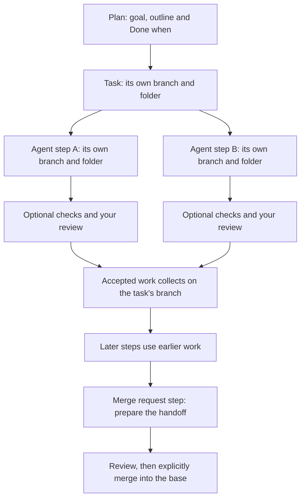

<p align="center">
  
</p>

<h1 align="center">Shepherd</h1>

<p align="center"><strong>Long tasks. Clear next steps.</strong></p>

<p align="center">
  <a href="https://www.npmjs.com/package/shepherd-agents"></a>
  <a href="https://www.npmjs.com/package/shepherd-agents"></a>
  <a href="LICENSE"></a>
  <a href="CONTRIBUTING.md"></a>
</p>

Shepherd is a free, open-source app that runs on your machine to plan, run and check long coding-agent work with Codex and Claude Code.

See what's done, what's running and what needs you. Keep the plan, progress and checks with the task.

## Start Shepherd

```sh
npx shepherd-agents
```

**macOS first · Node.js 22.12+ · Git** · Codex or Claude Code installed and signed in. Drafting steps, drafting checklists and checking work against a step require Codex.

Shepherd opens a private token address in your browser, starting at `127.0.0.1:5194`. Keep its terminal running; Ctrl+C stops it. Keep that address private: Shepherd can run commands with your permissions.

Linux should work where no Mac-only feature is needed. Windows is not supported yet. [Full setup, platform limits, launcher options and source install →](docs/setup.md)

## See the work

**Real app. Fictional Slice project. Run notes and results are sample data.**

<picture>
  <source media="(max-width: 600px)" srcset="docs/screenshots/task-outline-mobile.png">
  
</picture>

**The map:** Eight steps. Four done, two running, review and a merge request still ahead. **The phone outline:** The plan stays visible, one step at a time.

[Open the full map](docs/screenshots/task-map-desktop.png) · [Open the phone outline](docs/screenshots/task-outline-mobile.png)

## Why Shepherd exists

“Where exactly am I in this big agent task?”

A long chat makes that surprisingly hard to answer. The agent has a report. You have a goal. Somewhere between them are the steps, the checks and the part that still needs you.

Shepherd keeps those together. A project holds tasks. Each task has an outline, a map, a branch and a folder. Open a step to see its request, its progress and the evidence behind “done.” You can leave the browser and come back to the same place while the local server keeps working.

## A short tour

### 01 / Plan it

Write steps in the outline, or let Codex draft them from your goal. Assign each step to Codex, Claude Code or yourself. Add Done when items so the request has a clear finish.

The outline sets the order; indented steps can run side by side. Use arrows on the map when a step needs a different dependency. [Outline, shortcuts and saved steps →](docs/usage.md)

<details>
<summary>See the outline and a step's Done when progress</summary>

[](docs/screenshots/task-outline-desktop.png)

</details>

### 02 / Run it

The map shows which steps wait and which can run side by side. Each task has its own branch and folder. The timeline records progress notes, commands, checks and changed files so you can pick up where you left off.

<picture>
  <source media="(max-width: 600px)" srcset="docs/screenshots/step-output-mobile.png">
  
</picture>

Pick up the thread in the timeline: notes, commands and changed files, in order. [Desktop](docs/screenshots/step-output-desktop.png) · [Phone](docs/screenshots/step-output-mobile.png)

### 03 / Check it

An agent saying “done” is a starting point. Add a command check, ask Codex to check the work against the step, or ask to review it yourself. Read the results before moving on.

<a id="optional-checks"></a>

**Give “done” a definition.**

<picture>
  <source media="(max-width: 600px)" srcset="docs/screenshots/step-checks-mobile.png">
  
</picture>

The command passed. Codex also reviewed the work against this step's four Done when items. [Desktop](docs/screenshots/step-checks-desktop.png) · [Phone](docs/screenshots/step-checks-mobile.png)

Checks are optional. “Check the work against this step” uses a separate Codex run, even when Claude Code wrote the code. Agent progress marks and check results are different things. A passing check is evidence to review, not a guarantee that the work is correct. [How checks work, including retries and “can't tell” →](docs/checks.md)

### 04 / Merge it

Accepted steps collect in the task's branch. Add an “Open a merge request” step to prepare the handoff. Review the changes before bringing the task into its base branch.

That final step is visible at the right of [the map](docs/screenshots/task-map-desktop.png). It uses your existing authentication to open or update a GitLab merge request or GitHub pull request; Shepherd keeps the reported link on the task header. Nothing merges into your project checkout automatically. [Branches, merges and conflicts →](docs/runs.md)

### Keep tasks in their place

Switch tasks without losing their outlines or running state. Each task has its own goal, steps, activity and branch. Search across projects with **⌘K** (**Ctrl+K** elsewhere). [Tasks and human review →](docs/usage.md)

<details>
<summary>See projects and tasks</summary>

[](docs/screenshots/projects-tasks-desktop.png)

</details>

## How it works



The outline determines dependencies unless you set arrows by hand. Shepherd schedules up to four agents at once; each agent step gets a git worktree so parallel edits stay in separate folders. Checks gate acceptance when enabled. Failed checks can send work back to the agent. [Run lifecycle](docs/runs.md) · [Check rules](docs/checks.md) · [Limits](docs/limits.md)

## What you get

- **A place in the plan.** The outline, map and timeline show the work from different angles.
- **Your real agents.** Codex and Claude Code, your model choices, your logins. Give yourself steps, too.
- **A visible finish.** Done when progress, command checks, optional Codex work checks and human review.
- **Separate work, collected deliberately.** A branch and folder per task; a worktree per agent step; explicit merging into the base.
- **Steps worth keeping.** Save a useful review, browser check or merge request step for the next task.
- **Problems that stay visible.** Keep known issues with the work, pass them to later steps or turn them into new steps.
- **A local API.** Script the same board actions the app uses, with the startup token. [API reference →](docs/api.md)

## Your machine. Your agents. Your work.

Shepherd runs the real Codex and Claude Code with your own logins, repositories, connectors and skills.

Nothing goes to a Shepherd server: there is no hosted Shepherd service. No Shepherd account, hosted database or telemetry. Your agents, connectors, commands and git remotes can still contact services using your own configuration.

Shepherd is free and open source under the MIT license. Agent usage follows your provider's plan.

[Read the trust model](SECURITY.md). A worktree separates changes; it is not a security sandbox.

## FAQ

**Do I need both agents?** No. Install and sign in to Codex or Claude Code. Drafting steps, human checklists and the optional work check require Codex. Claude Code can run agent steps without Codex.

**Is “2 of 4” proof the work passed?** It is the agent's own account of its Done when progress. Checks have separate results. An unchecked agent step can finish when its agent exits; add checks and review where they matter.

**Does it work offline?** Shepherd has no hosted service. Your agents and tools may need their providers and network access. Your provider's usage costs still apply.

**Does it push or merge for me?** Pushing is opt-in per agent step. An agent prepares the merge request using your tools. Accepted steps merge into the task branch; merging that task into the project checkout needs your explicit action. Conflicts stop the merge. [Exact rules →](docs/checks.md)

**Can I use an existing repository?** Yes: select its top-level folder. It needs at least one commit and a checked-out branch. Shepherd creates separate worktrees and branches for the work. [Repository requirements →](docs/runs.md)

**What happens when I close the tab?** Runs continue while the terminal's server process is running. Restarting records interrupted runs as stopped. Deleting a task removes it from the board but leaves its branches, folders and files on disk. [Storage and cleanup →](docs/storage.md)

**Is the package published yet?** Publishing `shepherd-agents` is a final launch step; until then the npm badges read "package not found". Before publication, use the [source setup](docs/setup.md).

## Roadmap

The next milestone is the open-source launch: publish `shepherd-agents` and verify the install from a clean machine. These are release steps, not actions performed by the README.

After that, the direction is to refine long-task planning, checking and recovery from real use, and improve portability beyond macOS. Linux should work where Mac-only features are not needed; Windows support has no promised date. Bring concrete problems and small, reviewable improvements through [contributing](CONTRIBUTING.md).

## Documentation

The detailed reference is still here, with room to breathe:

- <a id="run-it"></a>[Setup](docs/setup.md): install, agent logins, platforms, launcher options and source development.
- [Settings and environment variables](docs/configuration.md): folders, models, browser helpers and precedence.
- <a id="using-it"></a>[Using Shepherd](docs/usage.md): tasks, outline shortcuts, saved steps, progress, known issues and merge requests.
- [How runs work](docs/runs.md): scheduling, prompts, branches, worktrees, sandbox and browser access.
- [Optional checks](docs/checks.md): command timeout, Codex verdicts, automatic retries and review.
- <a id="api"></a>[Local API](docs/api.md): authentication, actions, commands, tasks, progress and timelines.
- <a id="where-things-are-stored"></a>[Storage](docs/storage.md): board migrations, backups, evidence, retention and cleanup.
- <a id="limits"></a>[Limits](docs/limits.md): boundaries worth knowing before a big run.
- [Screenshots and safe demo](docs/screenshots/README.md) · [Brand assets](docs/brand/README.md) · [All docs](docs/README.md).

## Contributing

Found a rough edge? Have a useful saved-step idea? Start with the [contributing guide](CONTRIBUTING.md), use the repository's issue and pull request templates, and keep changes focused. Follow the [Code of Conduct](CODE_OF_CONDUCT.md); report vulnerabilities through [Security](SECURITY.md).

From a source checkout, check your work with:

```sh
npm ci
npx tsc -b && npx vitest run && npm run build
node docs/check-links.mjs
```


A little structure. A lot less herding.

## License

**[MIT](LICENSE) · © The Shepherd authors**
