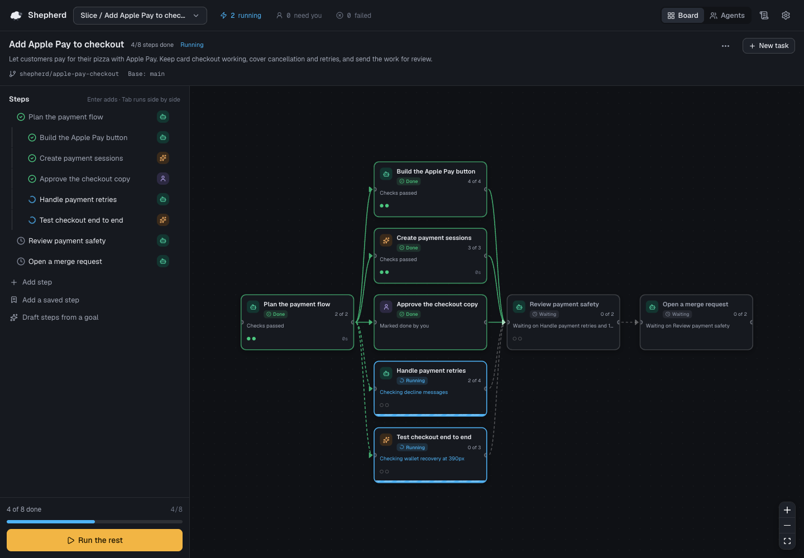
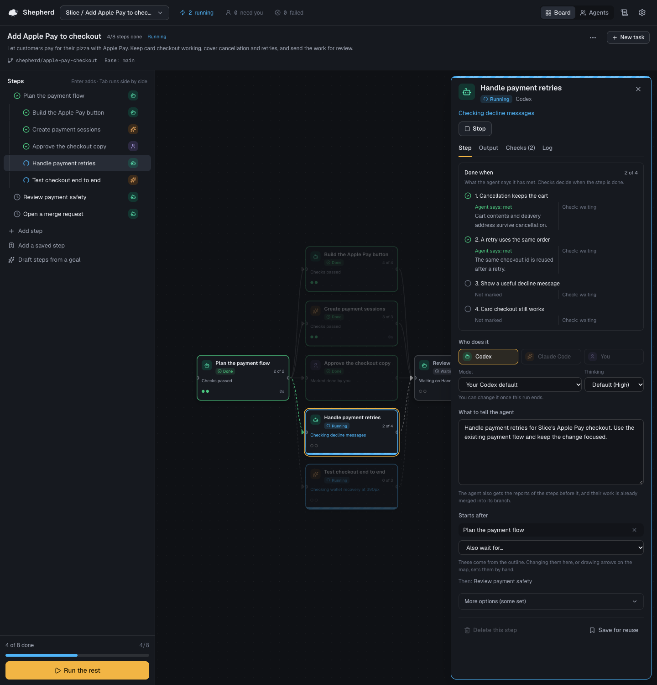
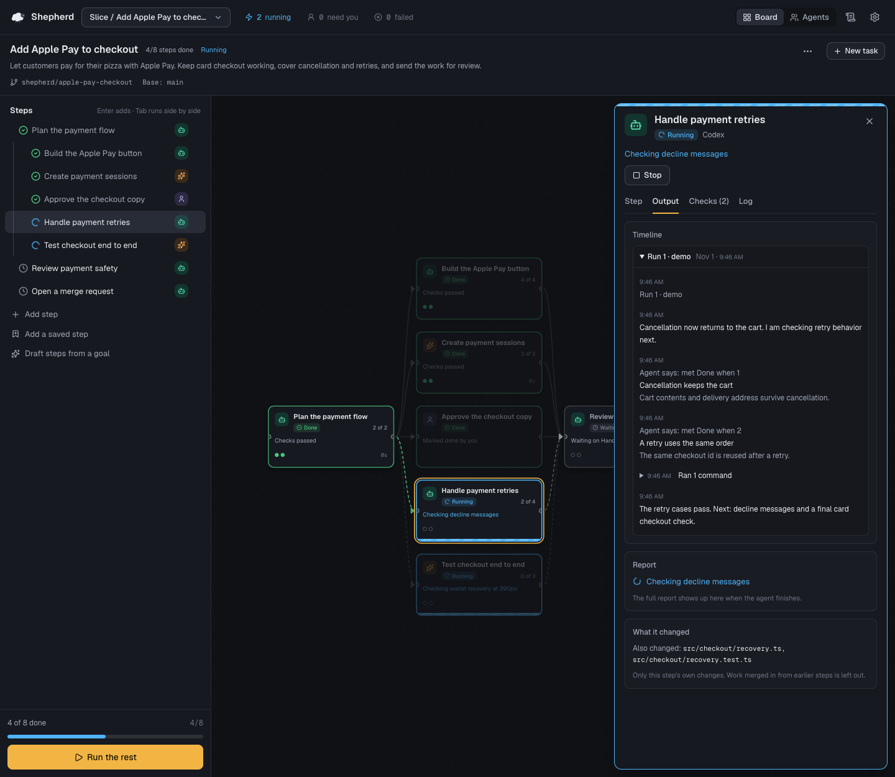
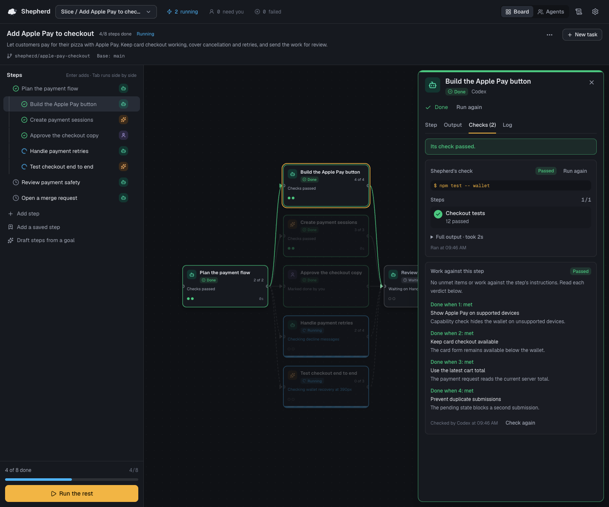
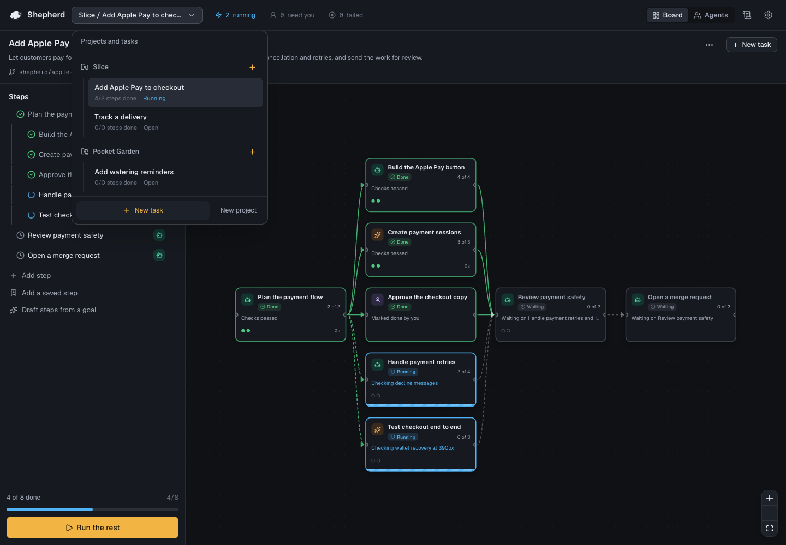
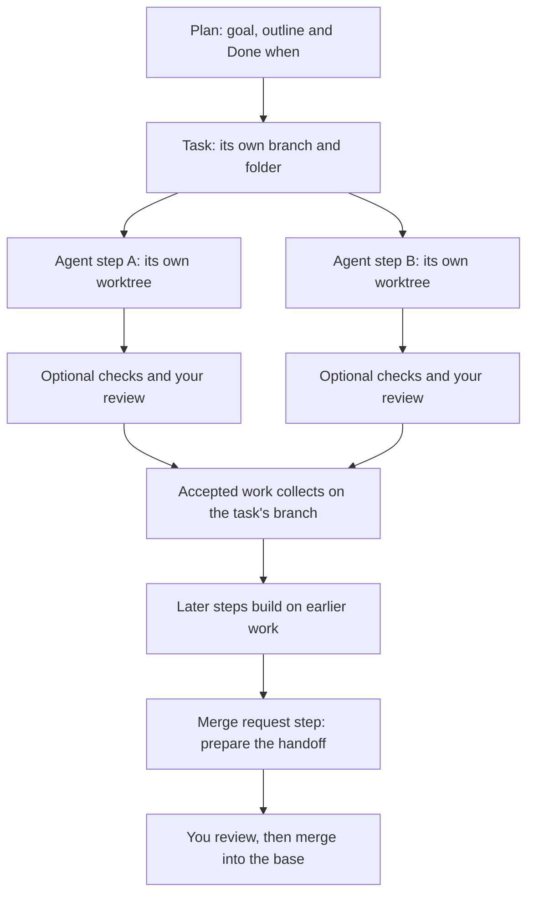

<p align="center">
  
</p>

<h1 align="center">Shepherd</h1>

<p align="center">
  <strong>Long tasks. Clear next steps.</strong><br>
  Herd Codex and Claude Code through big jobs, and always know where you are.
</p>

<p align="center">
  <a href="https://www.npmjs.com/package/shepherd-agents"></a>
  <a href="https://www.npmjs.com/package/shepherd-agents"></a>
  <a href="LICENSE"></a>
  <a href="CONTRIBUTING.md"></a>
</p>

<p align="center">
  <a href="#-quick-start"><b>Quick start</b></a> ·
  <a href="#-the-tour"><b>The tour</b></a> ·
  <a href="#-faq"><b>FAQ</b></a> ·
  <a href="https://shepherd-three-zeta.vercel.app"><b>Website</b></a> ·
  <a href="docs/README.md"><b>Docs</b></a>
</p>

---

> **“Wait… where exactly am I in this agent task?”**
>
> If you've ever scrolled back through a very long agent chat to work out what's done, what broke and what's still yours to do, Shepherd is for you.

Shepherd is a free, open-source app that runs on your machine. Write a plan, hand each step to **Codex**, **Claude Code** or **yourself**, and watch the whole job on one map: what's done ✅, what's running 🏃 and what needs you 👋. Every step keeps its request, its progress and the evidence behind “done.”

## 🚀 Quick start

```sh
npx shepherd-agents
```

That's the whole install. Shepherd opens a private address in your browser, starting at `127.0.0.1:5194`. Keep its terminal running; Ctrl+C stops it.

**You'll need** Node.js 22.12+, Git, and Codex or Claude Code installed and signed in.

- 🍎 **macOS first.** Linux should work where no Mac-only feature is needed. Windows isn't supported yet.
- 🔑 **Keep the address to yourself.** It carries a private token, and Shepherd can run commands with your permissions.
- ✍️ **Codex does the drafting.** Drafting steps, drafting checklists and checking work against a step use Codex.

[Full setup, launcher options and source install →](docs/setup.md)

## 👀 See it in action

<picture>
  <source media="(max-width: 600px)" srcset="docs/screenshots/task-outline-mobile.png">
  
</picture>

<p align="center"><sub>The real app with a fictional “Slice” project and sample run data. Eight steps: four done, two running, and review and a merge request still ahead.</sub></p>

## 🤔 Why Shepherd?

Long agent work rarely fails with a bang. It fails with fog. The agent has a report. You have a goal. Somewhere between them are the steps, the checks and the part that still needs you. Shepherd gives every one of those questions a place to live:

| The question | Where Shepherd answers it |
| --- | --- |
| “What's the plan again?” | 📝 **The outline.** It's the plan, and it sets the order. |
| “What's running right now?” | 🗺️ **The map.** Done, running, waiting and needs you, at a glance. |
| “What did the agent actually do?” | 🧵 **The timeline.** Progress notes, commands, checks and changed files, in order. |
| “Is it *really* done?” | ✅ **Done when, plus checks.** Command checks, a Codex work check and your own review. |
| “What still needs me?” | 👋 **Your steps.** Give yourself steps; they wait on the map like any other. |
| “Can I close the tab?” | 💤 **Yes.** Runs keep going while Shepherd's terminal is running. Come back to the same place. |

## 🎬 The tour

### 📝 1. Plan it

Write steps in the outline, or let Codex draft them from your goal. Hand each step to Codex, Claude Code or yourself, and add **Done when** items so every request has a finish line.

Indent steps to run them side by side. Draw arrows on the map when a step needs a different dependency. Save the good ones (a review, a browser check, a merge request step) and drop them into the next task. [Outline, shortcuts and saved steps →](docs/usage.md)

<details>
<summary>📸 <b>See the outline and a step's Done when progress</b></summary>
<br>

[](docs/screenshots/task-outline-desktop.png)

</details>

### 🏃 2. Run it

Press **Run** and Shepherd starts every step whose earlier steps are done, up to four agents at once. Each task gets its own branch and folder, and each agent step its own git worktree, so parallel edits stay out of each other's way.

The timeline records progress notes, commands, checks and changed files, so you can wander off and pick up exactly where you left off.

<picture>
  <source media="(max-width: 600px)" srcset="docs/screenshots/step-output-mobile.png">
  
</picture>

### ✅ 3. Check it

An agent saying “done” is where checking starts, not where it ends. Turn on as much as each step deserves:

- 🧪 **A check command**, like `npm test`. The step is done only when it exits 0.
- 🔍 **A Codex work check.** A separate, read-only Codex run grades the work against each Done when item, even when Claude Code wrote the code.
- 🙋 **Your own review**, before the work moves on.

Failed checks send the work back to the agent with the details, twice automatically while the plan runs. A passing check is evidence to read, not a guarantee. [How checks work, including “can't tell” →](docs/checks.md)

<picture>
  <source media="(max-width: 600px)" srcset="docs/screenshots/step-checks-mobile.png">
  
</picture>

### 🔀 4. Merge it

Accepted steps collect on the task's branch. Add an **Open a merge request** step, and an agent opens or updates a GitHub pull request or GitLab merge request with your existing login. Shepherd keeps the link on the task header.

Nothing lands in your project checkout until you say so. [Branches, merges and conflicts →](docs/runs.md)

### 🗂️ Bonus: lots of tasks, no confusion

Switch tasks without losing their outlines or running state. Each task has its own goal, steps, activity and branch. Search everything with **⌘K** (**Ctrl+K** elsewhere). [Tasks and human review →](docs/usage.md)

<details>
<summary>📸 <b>See projects and tasks</b></summary>
<br>

[](docs/screenshots/projects-tasks-desktop.png)

</details>

## 🧠 How it works



The outline sets dependencies unless you draw arrows by hand. Checks gate acceptance when they're on, and failed checks can send work back to the agent. [Run lifecycle](docs/runs.md) · [Check rules](docs/checks.md) · [Limits](docs/limits.md)

## 🎁 What you get

- 🧭 **A place in the plan.** The outline, the map and the timeline show the same work from three angles.
- 🤖 **Your real agents.** Codex and Claude Code with your model choices and your logins. Give yourself steps, too.
- 🏁 **A visible finish line.** Done when progress, command checks, optional Codex work checks and human review.
- 🌿 **Separate work, collected on purpose.** A branch and folder per task, a worktree per agent step, and explicit merging into the base.
- 📦 **Steps worth keeping.** Save a useful review, browser check or merge request step for the next task.
- 🐛 **Problems that stay visible.** Keep known issues with the work, pass them to later steps or turn them into new steps.
- 🔌 **A local API.** Script the same board actions the app uses, with the startup token. Agents Shepherd did not launch can find its address, token and guide in the data folder's `session.json` while it runs. [API reference →](docs/api.md)

## 🔒 Your machine. Your agents. Your work.

- 🏠 Shepherd runs the real Codex and Claude Code with your own logins, repositories, connectors and skills.
- 🙅 There's no Shepherd account, no hosted service, no hosted database and no telemetry.
- 🌐 Your agents, connectors, commands and git remotes can still reach the services you've configured.
- 💸 Shepherd is free and MIT licensed. Agent usage follows your provider's plan.
- 🛡️ A worktree separates changes; it isn't a security sandbox. [Read the trust model →](SECURITY.md)

## 🐑 Why a sheep?

Coding agents are a lot like a flock: capable, eager, and liable to wander off in different directions the moment you look away. Shepherd doesn't make them obedient or always right. Nothing does. It gives them a fenced field, a path to follow and someone counting at the gate.

## ❓ FAQ

<details>
<summary><b>Do I need both agents?</b></summary>
<br>

No. Install and sign in to Codex or Claude Code. Drafting steps, drafting human checklists and the optional work check use Codex. Claude Code can run agent steps without Codex.

</details>

<details>
<summary><b>Is “2 of 4” proof the work passed?</b></summary>
<br>

No. It's the agent's own account of its Done when progress. Checks have separate results. An unchecked agent step can finish when its agent exits, so add checks and review where they matter.

</details>

<details>
<summary><b>Does it work offline?</b></summary>
<br>

Shepherd itself has no hosted service, but your agents and tools may need their providers and the network. Your provider's usage costs still apply.

</details>

<details>
<summary><b>Will it push or merge behind my back?</b></summary>
<br>

No. Pushing is opt-in per agent step. An agent prepares the merge request using your tools. Accepted steps merge into the task branch; merging that task into your project checkout needs your explicit action, and conflicts stop the merge. [Exact rules →](docs/checks.md)

</details>

<details>
<summary><b>Can I point it at an existing repository?</b></summary>
<br>

Yes. Select its top-level folder. It needs at least one commit and a checked-out branch. Shepherd creates separate worktrees and branches for the work. [Repository requirements →](docs/runs.md)

</details>

<details>
<summary><b>What happens when I close the tab?</b></summary>
<br>

Runs continue while Shepherd's terminal is running. Restarting Shepherd records interrupted runs as stopped. Deleting a task removes it from the board but leaves its branches, folders and files on disk. [Storage and cleanup →](docs/storage.md)

</details>

## 🛣️ Roadmap

Next up: sharpen long-task planning, checking and recovery based on real use, and make Shepherd more at home beyond macOS. Linux should work where Mac-only features aren't needed; Windows support has no promised date. Got a concrete problem? [Open an issue](https://github.com/comountainclimber/shepherd/issues), or see [contributing](CONTRIBUTING.md).

## 📚 Documentation

- [Setup](docs/setup.md): install, agent logins, platforms, launcher options and source development.
- [Settings and environment variables](docs/configuration.md): folders, models, browser helpers and precedence.
- [Using Shepherd](docs/usage.md): tasks, outline shortcuts, saved steps, progress, known issues and merge requests.
- [How runs work](docs/runs.md): scheduling, prompts, branches, worktrees, sandbox and browser access.
- [Optional checks](docs/checks.md): command timeout, Codex verdicts, automatic retries and review.
- [Local API](docs/api.md): authentication, actions, commands, tasks, progress and timelines.
- [Storage](docs/storage.md): board migrations, backups, evidence, retention and cleanup.
- [Limits](docs/limits.md): boundaries worth knowing before a big run.
- [Screenshots and safe demo](docs/screenshots/README.md) · [Brand assets](docs/brand/README.md) · [All docs](docs/README.md)

## 🤝 Contributing

Found a rough edge? Have a saved step everyone should have? Start with the [contributing guide](CONTRIBUTING.md), use the issue and pull request templates, and keep changes focused. Follow the [Code of Conduct](CODE_OF_CONDUCT.md), and report vulnerabilities through [Security](SECURITY.md).

From a source checkout, check your work with:

```sh
npm ci
npx tsc -b && npx vitest run && npm run build
node docs/check-links.mjs
```

⭐ If Shepherd saves you a long scroll, a star helps other people find it.

---

<p align="center">
  <br>
  <b>A little structure. A lot less herding.</b><br>
  <sub><a href="LICENSE">MIT</a> · © The Shepherd authors</sub>
</p>
