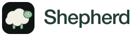
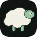
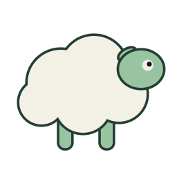

# Shepherd brand assets

Use these assets for both the launch page and repository README. The complete direction and final copy are in [site/BRIEF.md](../../site/BRIEF.md).

## Lockup

For light surfaces:

For dark surfaces, use [logo-dark.svg](logo-dark.svg). Both have transparent backgrounds and fixed vector wordmarks; they do not load fonts. Use the lockup at 144px wide or larger. Keep clear space of at least half the sheep badge's width on each side. Do not stretch, recolor, rotate or retype the lockup.

A logo used alone as a home link needs the accessible name “Shepherd”.

## README header

[hero.svg](hero.svg) opens the README: the sheep walks past Plan it, Run it, Check it and Merge it, and each card turns from waiting to done. It illustrates the workflow; it is not a record of a run. Its own Field background keeps it readable on GitHub's light and dark themes, and it shows the finished state without motion when the viewer prefers reduced motion. GitHub plays its CSS animation in an ordinary image tag, with no scripts or external requests. Its text uses system fonts.

## Mark and mascot

- [mark.svg](mark.svg): square, dark-backed badge for the favicon and compact uses. Keep it at least 24 × 24px. The field makes it visible on light and dark backgrounds.
- [mascot.svg](mascot.svg): transparent sheep, with fine Forest outlines for light backgrounds. Use at 48–96px for the closing step path. Keep its proportions and side-facing pose.

These are the same sheep, derived from the app's `Sheep` component in [Hud.tsx](../../src/components/shell/Hud.tsx), with wool and sage colors. Keep the five-circle fleece, two visible legs, tilted ear and one eye. No separate provider mascots, clothing, crook, landscape or second hero. Decorative sheep use empty alt text. Do not use a mascot as the sole signal of success or progress.

Apart from the README header, the launch assets are static. An illustration must not imply that a real task ran, a check passed or drift was caught. Follow the real screenshot disclosure and motion rules in the brief.

## Palette and typography

[tokens.css](tokens.css) contains the exact shared colors and local font declarations. Importing it only declares tokens and fonts; it does not style the product or enable a theme. Its font URLs are relative to this file, so preserve the `fonts/` layout when copying it into the final site's public assets.

- Field `#101412`: dark page and badge.
- Surface `#181E1A`: raised areas and command surround.
- Wool `#F3F0E5`: main text and copy-button fill.
- Muted `#ABB7AE`: supporting text on Field.
- Sage `#98C4A2`: links, focus and restrained accents on Field.
- Amber `#E3B875`: occasional human-attention cue.
- Line `#39473E`: decorative separators.
- Control line `#708775`: visible control boundaries on Field/Surface.
- Forest `#243E34`: foreground on light surfaces.

Body and headings use Geist. Commands and workflow numbers use Geist Mono. The bundled WOFF2 files are the local Latin variable subsets from the precise concept, already present in this repository. Use system font fallbacks and `font-display: swap`; do not fetch fonts. Keep captions at least 14px and body text at least 16px. README text stays native GitHub Markdown.

The wordmark uses fixed outlines made from the system Helvetica Neue Medium face; no font file is embedded or required to display it. Do not substitute it for the page's Geist text or alter its letter spacing.

## Provenance and license

The sheep derives from Shepherd's existing in-repository SVG geometry. Logo composition, palette and SVG artwork are distributed under this repository's [MIT license](../../LICENSE), copyright The Shepherd authors. The outlined wordmark is an image, not a redistributed font.

Geist and Geist Mono remain under the SIL Open Font License 1.1. Their full notices are retained in [fonts/geist-LICENSE.txt](fonts/geist-LICENSE.txt) and [fonts/geist-mono-LICENSE.txt](fonts/geist-mono-LICENSE.txt). Keep those files with redistributed font assets. Do not describe the fonts themselves as MIT licensed.

All SVGs are self-contained, with no scripts, external references, linked fonts or raster content. Product screenshots stay in [docs/screenshots](../screenshots/), with their sample-data disclosure; do not move or recolor them as brand art.
